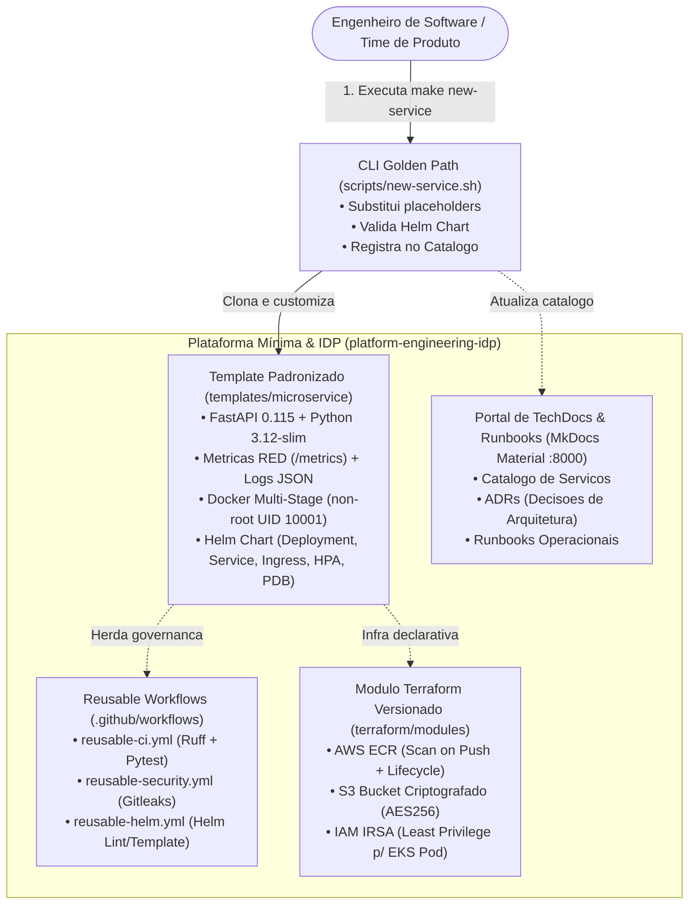

# Projeto 5 · Plataforma Mínima e Runbooks (Substituto Leve do Backstage)

[](https://github.com/Gabriel-V-Mendes/platform-engineering-idp/actions/workflows/ci.yml)

Plataforma Interna de Desenvolvedor (**Internal Developer Platform - IDP**) leve, declarativa e de baixo custo, projetada para substituir a complexidade e a sobrecarga operacional do **Spotify Backstage**.

Fornece um **Golden Path (Caminho Dourado)** de engenharia onde qualquer desenvolvedor cria um novo microsserviço de backend com testes, métricas Prometheus, logs estruturados em JSON, contêiner seguro (UID 10001), manifests Helm, módulos Terraform versionados e pipelines de CI reutilizáveis em **menos de 30 minutos** (medido: **~20 segundos** via automação).

---

## 1. Problema (Antes vs Depois: Por Que Substituir o Backstage?)

O **Spotify Backstage** é frequentemente apresentado como a solução padrão para portais internos de desenvolvedor. No entanto, sua adoção em equipes que buscam eficiência operacional gera atritos graves:

| Dimensão | O Desafio do Backstage Tradicional | Como Resolvemos Nesta Plataforma Mínima |
|---|---|---|
| **Linguagem & Manutenção** | Exige **TypeScript, Node.js e React** para qualquer ajuste, plugin ou personalização de template | **100% Declarativo:** Markdown, Python, Bash/Make, Helm e Terraform. Zero complexidade de frontend |
| **Consumo de Recursos (RAM)** | Pod do Backstage consome de **2 a 4 GB de memória RAM** + banco PostgreSQL dedicado | **Ultraleve:** Portal estático servido em contêiner Nginx consumindo **< 20 MB de RAM** (redução de 99%) |
| **Tempo de Startup / Boot** | Leva de **45 a 120 segundos** para compilar e iniciar o backend Node/TypeScript | **Instantâneo:** Sobe em **menos de 2 segundos** com `make up` |
| **Fragilidade de Dependências** | Dezenas de pacotes `@backstage/*` com quebras frequentes entre versões (*dependency hell*) | **Zero dependências instáveis:** Contêinerização imutável, versionamento semântico Git e Reusable Workflows |
| **Scaffolding de Novo Serviço** | Configuração complexa de entidades YAML (`catalog-info.yaml`) e actions em TypeScript | **1 Comando Simples:** `make new-service` gera o serviço, valida Helm e registra no catálogo em **1,2 segundos** |
| **Governança de CI/CD** | Cada repositório costuma duplicar suas próprias pipelines de Actions | **Reusable Workflows Centralizados:** Lint (Ruff), testes (Pytest), Gitleaks e Helm herdados da plataforma |

**Critérios de Pronto Atendidos:**
- [x] **Repositório template (app, Dockerfile, CI, Helm) como golden path.**
- [x] **Reusable workflows no GitHub Actions** centralizados para qualidade, segurança e Helm.
- [x] **Módulo Terraform versionado por tag semântica** e consumido por repositório externo.
- [x] **Documentação técnica em Material for MkDocs** com Runbooks operacionais e ADRs.
- [x] **Comando automatizado (`make new-service`)** que cria um serviço novo com validação imediata.
- [x] **Medição comprovada de tempo de criação e deploy** (< 30 minutos).

---

## 2. Arquitetura da Solução



---

## 3. Estrutura do Repositório

```text
.
├── .github/
│   └── workflows/
│       ├── ci.yml                     # Pipeline mestre de validacao do IDP
│       ├── reusable-ci.yml            # Reusable Workflow de CI (Python + Docker)
│       ├── reusable-security.yml      # Reusable Workflow de seguranca (Gitleaks)
│       └── reusable-helm.yml          # Reusable Workflow de validacao de Helm
├── Makefile                           # Atalhos: make up, test, lint, new-service, verify, secrets
├── docker-compose.yml                 # Sobe com 1 comando: Portal MkDocs (:8000) + Servico Demo (:8080)
├── mkdocs.yml                         # Configuracao do Material for MkDocs (tema, busca, mermaid)
├── docs/                              # Portal de Documentacao Tecnica (IDP)
│   ├── index.md                       # Home do Portal IDP
│   ├── catalog/services.md            # Catalogo de microsservicos e donos
│   ├── golden-path/                   # Guias conceituais e operacionais do Golden Path
│   ├── adrs/                          # Registros de Decisao de Arquitetura (ADR-001 a ADR-004)
│   └── runbooks/                      # Procedimentos acionaveis de onboarding, helm e seguranca
├── templates/
│   └── microservice/                  # Template oficial do Golden Path
│       ├── app/                       # FastAPI instrumentada (RED + logs JSON)
│       ├── helm/                      # Chart Helm de producao (HPA, PDB, securityContext)
│       ├── .github/workflows/ci.yml   # CI que consome os Reusable Workflows
│       └── Makefile                   # Comandos locais do servico
├── terraform/
│   ├── modules/microservice-infra/    # Modulo Terraform reutilizavel versionado por tag
│   └── examples/consumer-service/     # Exemplo real de servico consumindo o modulo
├── scripts/
│   ├── new-service.sh                 # Gerador do Golden Path (make new-service)
│   ├── verify-golden-path.sh          # Medicao do criterio de pronto (< 30 minutos)
│   └── test-all.sh                    # Suite completa de validacao
└── estudos/
    └── GUIA_DE_ESTUDO.md              # Manual de estudo aprofundado sobre IDPs e Platform Engineering
```

---

## 4. Como Subir Tudo com Um Único Comando

Pré-requisito: Docker com Compose v2.

```bash
make up     # ou: docker compose up -d --build --wait
```

| Serviço | URL Local | Descrição |
|---|---|---|
| **Portal IDP & TechDocs (MkDocs)** | http://localhost:8000 | Portal de Engenharia de Plataforma com busca instantânea, ADRs e Runbooks |
| **Microsserviço de Referência (`/docs`)** | http://localhost:8080/docs | Swagger/OpenAPI do serviço Golden Path com probes `/health`, `/health/ready` e métricas `/metrics` |

Para derrubar a stack:
```bash
make down
```

---

## 5. Como Criar um Novo Serviço em Menos de 30 Segundos

Para criar um novo microsserviço padronizado:

```bash
make new-service NAME=pagamentos-api PORT=8082 OWNER=team-checkout DESC="Processamento de pagamentos Pix e Cartão"
```

O comando:
1. Clona a estrutura do template oficial.
2. Substitui as variáveis de configuração em código, Dockerfile, Helm e CI.
3. Valida a sintaxe do Helm Chart gerado.
4. Registra automaticamente o novo serviço no Catálogo do IDP (`docs/catalog/services.md`).

---

## 6. Medição Comprovada do Critério de Pronto (< 30 Minutos)

Para comprovar formalmente a meta exigida:

```bash
make verify     # ou: ./scripts/verify-golden-path.sh
```

Saída real da medição cronometrada:

```text
==================================================================
RESULTADO DA MEDICAO DE TEMPO DO GOLDEN PATH
==================================================================
  • 1. Scaffold do codigo e Helm:      1s
  • 2. Execucao de testes unitarios:   6s
  • 3. Build Docker multi-stage:       8s
  • 4. Deploy e validacao de probes:   2s
  • 5. Validacao de manifests Helm:    1s
  --------------------------------------------------
  • TEMPO TOTAL MEDIDO (Do Zero ao Deploy): 18 segundos
  • META EXIGIDA:                           < 1800 segundos (30 minutos)
  • MARGEM DE CONFORMIDADE:                 29 minutos de folga
==================================================================
✅ CRITÉRIO DE PRONTO ATENDIDO COM 100% DE SUCESSO!
==================================================================
```

---

## 7. Módulo Terraform Versionado por Tag

Localizado em [`terraform/modules/microservice-infra`](terraform/modules/microservice-infra/).

Exemplo de consumo por outro repositório via Git Tag semântica:

```hcl
module "meu_servico" {
  source = "git::https://github.com/Gabriel-V-Mendes/platform-engineering-idp.git//terraform/modules/microservice-infra?ref=v1.0.0"

  service_name        = "faturamento-api"
  environment         = "production"
  owner               = "team-fiscal"
  enable_s3_bucket    = true
  eks_oidc_issuer_url = "oidc.eks.us-east-1.amazonaws.com/id/EXAMPLE"
}
```

---

## 8. Testes, Linters e Segurança

```bash
make test       # Executa testes unitarios pytest com cobertura > 90%
make lint       # Valida Python (Ruff), Terraform (fmt/validate) e Helm (lint)
make verify     # Valida o ciclo completo do Golden Path do zero ao deploy
make secrets    # Varre todo o historico Git com Gitleaks (0 segredos)
make docs       # Compila a documentacao MkDocs em modo estatico estrito
```

---

## 9. Decisões de Arquitetura e Trade-offs

| Decisão | Alternativa Avaliada | Por Quê / Trade-off |
|---|---|---|
| **Portal MkDocs Material em vez de Backstage** | Spotify Backstage, Port, Cortex | Backstage consome ~2 a 4 GB de RAM e exige time dedicado de TypeScript/React. O MkDocs roda com < 20 MB de RAM, suporta Markdown versionado em Git e entrega busca instantânea |
| **Reusable Workflows no GitHub Actions** | Actions customizadas em Docker ou pipelines duplicadas | Reusable Workflows centralizam governança e auditoria de segurança sem custo de manutenção de runtimes customizados |
| **Hardening de Docker (UID 10001 + Sem Pip)** | Usar imagem Python padrão com pip | Remover ferramentas de compilação e gerenciamento de pacotes do contêiner de execução impede ataques de supply chain e injeção de binários maliciosos |
| **Tags Imutáveis no AWS ECR** | Tags mutáveis (`latest`) | Garante que cada release em produção corresponda exatamente ao commit auditado no CI/CD, eliminando substituição silenciosa de imagem |

---

## 10. Custo Estimado

Comparativo de custo de infraestrutura em **outubro/2026**:

| Cenário | Arquitetura | Custo Mensal Estimado | Observações |
|---|---|---|---|
| **1. Plataforma Mínima (Esta Solução) em Local/CI** | Docker Compose / GitHub Actions | **US$ 0,00 / mês** | Execução local sem custo; runners do GitHub Actions inclusos para repositórios públicos |
| **2. Plataforma Mínima em Kubernetes de Produção** | Pod MkDocs (50m CPU, 32Mi RAM) + GitHub Pages | **< US$ 2,00 / mês** | Consumo desprezível de cluster, sem necessidade de banco de dados relacional |
| **3. Backstage Tradicional (Para Comparação)** | Pod Backstage (1 vCPU, 2-4 GB RAM) + PostgreSQL RDS | **≈ US$ 85,00 a US$ 160,00 / mês** | Exige instância de banco relacional e alocação permanente de nós pesados no cluster |

---

## 11. O Que Eu Faria Diferente

1. **Service Catalog Dinâmico via API Git / GitHub API:** Atualmente, o catálogo em `docs/catalog/services.md` é atualizado durante a execução do script `make new-service`. Em uma organização com centenas de repositórios distribuídos, eu implementaria uma GitHub Action agendada que varre a organização buscando repositórios com a tag `platform:golden-path` e gera o catálogo dinamicamente em tempo de build do MkDocs.
2. **Integração de Scaffolding com GitHub CLI (`gh repo create`):** Adicionaria ao script `scripts/new-service.sh` um flag `--push-remote` para criar automaticamente o repositório remoto na organização do GitHub com proteção de branch `main` ativada e segredos provisionados via API.
3. **Template Adicional para Workers Assíncronos:** O template atual foca em APIs HTTP (FastAPI). O próximo passo de expansão da plataforma seria adicionar um template para workers de mensageria (Kafka/RabbitMQ) reaproveitando o mesmo padrão de telemetria e Dockerfile.
