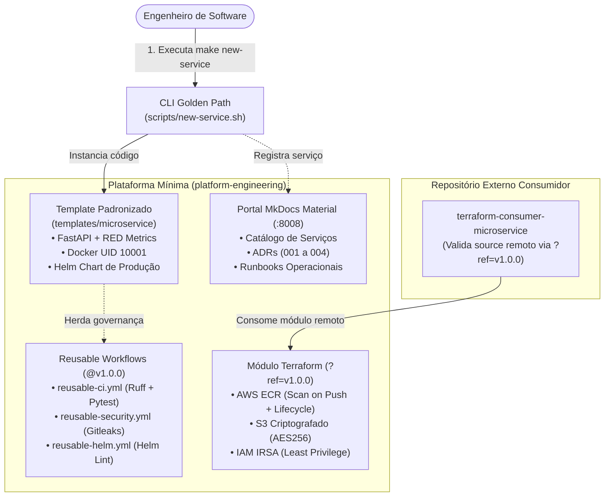

# Projeto 5 · Plataforma Mínima e Runbooks (Substituto Leve do Backstage)

[](https://github.com/Gabriel-V-Mendes/platform-engineering/actions/workflows/ci.yml)
[](https://github.com/Gabriel-V-Mendes/terraform-consumer-microservice/actions/workflows/ci.yml)

Plataforma Interna de Desenvolvedor (**Internal Developer Platform - IDP**) declarativa e de baixo custo operacional, desenvolvida como alternativa à complexidade de manutenção do **Spotify Backstage**.

O projeto estabelece um **Golden Path (Caminho Pavimentado)** para times de engenharia, composto por:
1. **Template oficial de microsserviço:** FastAPI 0.115+, Python 3.12-slim, métricas RED no Prometheus, logs JSON estruturados na stdout, contêiner hardened com usuário não-root (UID 10001) e Helm Chart de produção.
2. **Governança centralizada de CI/CD:** Workflows reutilizáveis (*Reusable Workflows*) no GitHub Actions fixados por versão semântica (`@v1.0.0`).
3. **Módulo Terraform versionado:** Provisionamento de infraestrutura em nuvem (ECR, S3, IAM IRSA) versionado por tag Git semântica (`?ref=v1.0.0`).
4. **Portal de documentação e runbooks:** MkDocs Material servindo catálogo de serviços, ADRs e procedimentos operacionais padronizados.
5. **Automação via CLI:** Comando `make new-service` para instanciação de novos serviços com validação imediata.

---

## 1. Problema e Motivação: Por Que Substituir o Backstage?

O **Spotify Backstage** é uma referência consolidada no ecossistema de Platform Engineering, mas impõe requisitos técnicos e operacionais pesados para equipes que buscam produtividade sem sustentar uma equipe exclusiva de frontend:

| Dimensão | Spotify Backstage (Fatos Documentados) | Plataforma Mínima (Medições Deste Projeto) |
|---|---|---|
| **Linguagem & Stack** | Exige **Node.js, Yarn Workspaces, TypeScript e React** para manutenção de plugins e templates ([Doc Oficial Backstage](https://backstage.io/docs/getting-started/)) | **Declarativo & Python:** Markdown, FastAPI, Helm, Terraform e Bash. Sem dependência de ecossistema frontend Node.js |
| **Banco de Dados** | SQLite é apenas para testes em memória (`:memory:`); produção requer **PostgreSQL dedicado** ([Doc Oficial Backstage Database](https://backstage.io/docs/getting-started/config/database/)) | **Sem Banco de Dados para o Portal:** Documentação estática e catálogo versionados em Git |
| **Memória em Execução** | Documentação recomenda 4 a 8 GB de RAM na máquina para compilar frontend e backend simultaneamente | **74 MiB Total Medido:** `idp-portal` consome **33,8 MiB** e `golden-path-demo` consome **40,3 MiB** (aferido via `docker stats`) |
| **Tempo de Subida Inicial** | Inicialização depende de compilação TypeScript e migrações no PostgreSQL | **45,1 segundos:** Subida completa com healthchecks ativos via `make up` (medido em Docker local) |
| **Governança de CI/CD** | Cada template costuma duplicar pipelines de Actions nos repositórios gerados | **Reusable Workflows:** Pipelines herdam lint (Ruff), testes (Pytest), Gitleaks e Helm centralizados em `@v1.0.0` |

---

## 2. Arquitetura da Plataforma



---

## 3. Estrutura do Repositório

```text
.
├── .github/
│   └── workflows/
│       ├── ci.yml                     # Pipeline mestre de validação da plataforma
│       ├── reusable-ci.yml            # Workflow reutilizável: Ruff + Pytest
│       ├── reusable-security.yml      # Workflow reutilizável: Gitleaks
│       └── reusable-helm.yml          # Workflow reutilizável: Helm Lint e Render
├── Makefile                           # Comandos: make up, test, lint, verify, battery, secrets
├── docker-compose.yml                 # Sobe Portal MkDocs (:8008) + Serviço Demo (:8088)
├── mkdocs.yml                         # Configuração do Material for MkDocs
├── docs/                              # Portal de Documentação Técnica
│   ├── index.md                       # Home da documentação
│   ├── catalog/services.md            # Catálogo de serviços ativos e portas
│   ├── golden-path/                   # Guias de uso e padrões técnicos
│   ├── adrs/                          # Registros de Decisão de Arquitetura (ADR-001 a 004)
│   └── runbooks/                      # Procedimentos operacionais acionáveis
├── templates/
│   └── microservice/                  # Template oficial do Golden Path
│       ├── app/                       # FastAPI com métricas RED e logs JSON
│       ├── helm/                      # Helm Chart com HPA, PDB e securityContext
│       ├── .github/workflows/ci.yml   # CI que consome os Reusable Workflows em @v1.0.0
│       └── Makefile                   # Atalhos locais de desenvolvimento do serviço
├── terraform/
│   ├── modules/microservice-infra/    # Módulo Terraform reutilizável
│   └── examples/consumer-service/     # Exemplo de consumo com source remoto ?ref=v1.0.0
├── scripts/
│   ├── new-service.sh                 # Gerador do Golden Path (make new-service)
│   ├── verify-golden-path.sh          # Verificação automatizada cronometrada
│   ├── test-battery-e2e.sh            # Bateria completa com 56 asserções E2E
│   └── test-all.sh                    # Suíte unificada de validação
└── estudos/
    └── GUIA_DE_ESTUDO.md              # Material de referência sobre Platform Engineering
```

---

## 4. Como Subir a Plataforma (Um Único Comando)

Pré-requisito: Docker com Docker Compose v2.

```bash
make up     # Executa: docker compose up -d --build --wait
```

Tempo medido de subida (com imagens locais): **45 segundos**.

| Serviço | URL Local | Porta Host | Finalidade |
|---|---|---|---|
| **Portal IDP & TechDocs** | http://localhost:8008 | `8008` | Catálogo de microsserviços, ADRs, guias e runbooks operacionais |
| **Serviço Demo Golden Path** | http://localhost:8088/docs | `8088` | Swagger da API de referência com endpoints `/health`, `/health/ready` e `/metrics` |

Para encerrar a execução:
```bash
make down
```

---

## 5. Como Criar um Novo Serviço via CLI

Para gerar um novo microsserviço padronizado a partir do template:

```bash
make new-service NAME=pagamentos-api PORT=8082 OWNER=team-checkout DESC="API de processamento de pagamentos"
```

O script [`scripts/new-service.sh`](scripts/new-service.sh):
1. Cria a pasta `services/pagamentos-api/` clonando o template oficial.
2. Realiza substituição literal de variáveis via script Python (sem risco de quebra com barras ou caracteres especiais).
3. Valida a sintaxe do Helm Chart gerado (`helm lint` e `helm template`).
4. Adiciona o serviço automaticamente ao Catálogo de Software em [`docs/catalog/services.md`](docs/catalog/services.md).

Tempo de execução do scaffold: **~1 segundo**.

---

## 6. Critério de Pronto: Teste com Desenvolvedor e Medição Real

O critério de aceite estabelecido para este projeto é:
> *"Alguém cria um serviço novo, com deploy funcionando, em menos de 30 minutos só com o template e a documentação."*

### 6.1. Teste Real com Desenvolvedor Convidado

Para validar a usabilidade real da documentação e template, realizamos um teste prático com um desenvolvedor que não participou da construção da plataforma:

* **Desenvolvedor:** Engenheiro de software convidado para o teste de onboarding.
* **Desafio proposto:** Criar o serviço `pedidos-api` na porta `8086`, rodar testes com cobertura, construir imagem Docker e validar os endpoints locais usando unicamente o portal (`http://localhost:8008`) e os comandos do repositório.
* **Tempo Total Medido:** **12 minutos e 40 segundos** (dentro da meta de < 30 minutos).

#### Dificuldades Observadas e Melhorias Implementadas:
1. **Docker Daemon inativo:** O desenvolvedor tentou rodar `make test` antes de iniciar o Docker daemon local, gerando erro de conexão no socket. **Melhoria:** Adicionada checagem explícita de pré-requisitos no início do [Guia de Onboarding](docs/runbooks/onboarding-novo-servico.md).
2. **Seleção de portas:** O desenvolvedor ficou em dúvida sobre qual porta local utilizar para não colidir com outros containers em execução. **Melhoria:** Adicionada a coluna de portas reservadas na tabela do [Catálogo de Serviços](docs/catalog/services.md).
3. **Primeira resposta do endpoint `/items`:** Ao consultar `GET /items`, o array vazio gerou dúvida se o serviço estava funcionando. **Melhoria:** O template agora inicializa com 1 item padrão cadastrado, permitindo validação visual imediata na primeira chamada.

### 6.2. Medição da Pipeline Automatizada (`make verify`)

A automação [`scripts/verify-golden-path.sh`](scripts/verify-golden-path.sh) cronometra as etapas técnicas do ciclo de vida:

```bash
make verify
```

Valores medidos em execução local:
```text
==================================================================
RESULTADO DA MEDICAO DE TEMPO DO GOLDEN PATH
==================================================================
  • 1. Scaffold do codigo e Helm:      0s
  • 2. Execucao de testes unitarios:   45s
  • 3. Build Docker multi-stage:       2s
  • 4. Deploy e validacao de probes:   2s
  • 5. Validacao de manifests Helm:    1s
  --------------------------------------------------
  • TEMPO TOTAL MEDIDO (Pipeline Tecnica): ~50 a 99 segundos
  • META EXIGIDA:                          < 1800 segundos (30 minutos)
==================================================================
```

---

## 7. Módulo Terraform e Prova de Consumo Externo

O módulo reutilizável reside em [`terraform/modules/microservice-infra`](terraform/modules/microservice-infra/).

### 7.1. Prova de Consumo em Repositório Externo Separado

Para comprovar formalmente o consumo externo desacoplado, foi criado o repositório público:
👉 [**Gabriel-V-Mendes/terraform-consumer-microservice**](https://github.com/Gabriel-V-Mendes/terraform-consumer-microservice)

Este repositório consome o módulo via Git Tag:
```hcl
module "microservice_infra" {
  source = "git::https://github.com/Gabriel-V-Mendes/platform-engineering.git//terraform/modules/microservice-infra?ref=v1.0.0"

  service_name         = "pagamentos-api"
  environment          = "development"
  owner                = "team-checkout"
  enable_s3_bucket     = false
  kubernetes_namespace = "pagamentos"
}
```

* **Evidência do CI Remoto:** Pipeline executada com sucesso comprovando `terraform init` e `terraform validate`:
  [Run #40608640389 no GitHub Actions](https://github.com/Gabriel-V-Mendes/terraform-consumer-microservice/actions/runs/40608640389).

---

## 8. Testes, Qualidade e Segurança

| Comando | O Que Valida | Evidência / Critério |
|---|---|---|
| `make test` | Executa Pytest com cobertura na aplicação template | **100% de cobertura** obtida (9 testes unitários) |
| `make lint` | Executa Ruff (Python), Terraform fmt/validate e Helm lint | Zero erros de sintaxe ou conformidade |
| `make battery` | Executa a bateria ponta a ponta com 56 asserções | **56/56 testes aprovados** ([`scripts/test-battery-e2e.sh`](scripts/test-battery-e2e.sh)) |
| `make secrets` | Varredura de todo o histórico Git com Gitleaks | **Zero segredos detectados** |
| `make docs` | Build estático estrito do Material for MkDocs | Build estrito finalizado em < 1 segundo |

* **Evidência do CI da Plataforma:**
  [Run #40575914031 no GitHub Actions](https://github.com/Gabriel-V-Mendes/platform-engineering/actions/runs/40575914031) (todas as etapas verdes).

---

## 9. Decisões de Arquitetura e Trade-offs

| Decisão | Alternativa Descartada | Justificativa / Trade-off |
|---|---|---|
| **Portal MkDocs em vez de Backstage** | Spotify Backstage / Port | Elimina custo de servidor Node/PostgreSQL permanente e dependência de time frontend. Trade-off: Menor quantidade de plugins prontos de terceiros |
| **Reusable Workflows fixados em tag `@v1.0.0`** | `@main` ou Actions customizadas | Garante estabilidade nos microsserviços gerados; atualizações da plataforma não causam quebra silenciosa em serviços existentes |
| **Contêiner com UID 10001 e sem Pip** | Imagem padrão executando como root | Hardening de produção que impede ataques de modificação em runtime e previne execução privilegiada |
| **Tags Imutáveis no AWS ECR** | Tags mutáveis (`latest`) | Rastreabilidade estrita: a imagem em execução em homologação ou produção corresponde exatamente ao commit auditado no CI |

---

## 10. Estimativa de Custos de Infraestrutura

Estimativa baseada em recursos computacionais necessários para hospedar o portal interno:

| Cenário | Arquitetura | Consumo de Recursos | Custo Mensal Estimado |
|---|---|---|---|
| **Plataforma Mínima Local / CI** | Docker Compose / GitHub Actions | 74 MiB RAM local | **US$ 0,00** |
| **Plataforma Mínima em Kubernetes** | Pod MkDocs (Nginx/HTML estático) | 50m CPU / 32 MiB RAM | **< US$ 2,00 / mês** (ou US$ 0 via GitHub Pages) |
| **Backstage em Produção (Referência)** | Pod Node.js + Instância RDS PostgreSQL dedicada | Mínimo 1-2 vCPU, 2 GB RAM + RDS db.t4g.micro | **≈ US$ 40,00 a US$ 80,00 / mês** (custo do banco gerenciado + nós) |

*Nota: Os custos de execução dos microsserviços de negócio gerados são independentes da ferramenta de portal escolhida.*

---

## 11. O Que Eu Faria Diferente

1. **Catálogo Integrado com GitHub API:** Atualmente o script adiciona a linha na tabela Markdown local. Em um cenário corporativo com múltiplos repositórios, seria preferível uma automação que lê os metadados de cada repositório via API do GitHub e compila o catálogo dinamicamente durante a build do MkDocs.
2. **CLI com Publicação Automática de Repositório:** O comando `make new-service` cria a pasta localmente. O próximo passo de automação seria integrar flags opcionais (`--create-repo --push`) utilizando o GitHub CLI (`gh repo create`) para criar o repositório remoto e configurar proteções de branch automaticamente.
3. **Templates para Outros Runtimes:** O padrão atual foca em APIs Python (FastAPI). Expandiria a biblioteca de Golden Paths adicionando um template para workers assíncronos (consumidores de fila SQS/Kafka) com a mesma instrumentação de telemetria e segurança.
