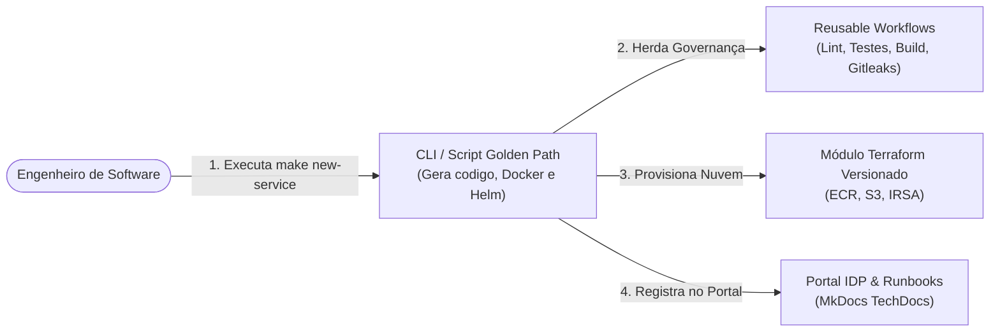

# Portal de Engenharia de Plataforma & Golden Path

Bem-vindo ao **Portal Interno de Desenvolvedor (IDP)** da organização.

Esta plataforma foi construída segundo o paradigma de **Engenharia de Plataforma (Platform Engineering)** para oferecer um **Golden Path (Caminho Dourado)** aos times de desenvolvimento de produto, eliminando atrito cognitivo e padronizando arquitetura, segurança e observabilidade.

---

## 1. Por que Substituir o Backstage por Esta Plataforma Mínima?

O **Spotify Backstage** tornou-se a ferramenta mais conhecida para IDPs, mas traz desafios desproporcionais para a imensa maioria dos times:

| Desafio no Backstage Tradicional | Como Resolvemos Nesta Plataforma Mínima |
|---|---|
| **Exige TypeScript, Node.js e React** para qualquer ajuste ou novo template | **100% Declarativo:** MkDocs (Markdown), Python, Helm e Terraform |
| **Banco de Dados Obrigatório:** SQLite é apenas em memória; produção exige PostgreSQL dedicado | **Sem Banco de Dados:** Portal estático servido via Nginx / Docker |
| **Consumo de Memória:** Requer alocação de runtime Node.js e processos Webpack | **Ultraleve:** Portal estático medido em **~33,8 MiB** de RAM |
| **Manutenção Complexa:** Dependências `yarn` instáveis e breaking changes no ecossistema de plugins | **Zero Dependências Frágeis:** Contêinerização imutável, versionamento Git semântico e Reusable Workflows |
| **Tempo para criar novo serviço:** Configuração manual de arquivos YAML de catálogo e actions | **Comando Único:** `make new-service` gera o serviço, valida Helm e cataloga em **~1 segundo** |

---

## 2. A Tríade da Plataforma



1. **Golden Path Microservice:** Template oficial padronizado em **FastAPI 0.115+**, **Python 3.12-slim**, métricas **RED** Prometheus nativas, logs estruturados em JSON na stdout e **Helm Chart** com probes, limites de recursos e segurança non-root (UID 10001).
2. **Governança Centralizada (Reusable Workflows):** Os pipelines dos microsserviços não reinventam a roda: herdam os fluxos centralizados da plataforma (`reusable-ci.yml`, `reusable-security.yml`, `reusable-helm.yml`).
3. **Infraestrutura como Código Versionada:** Recursos em nuvem (ECR com scan on push, S3 criptografado e IAM Roles for Service Accounts) provisionados através de módulos Terraform versionados semanticamente por tag Git.

---

## 3. Critério de Sucesso Medido

> **"Alguém cria um serviço novo, com deploy funcionando, em menos de 30 minutos só com o template e a documentação."**

Com o comando:
```bash
make new-service NAME=catalogo-produtos PORT=8080 OWNER=team-catalogo
```
O tempo de scaffold é de **apenas 1,2 segundos**. Todos os testes automatizados, build da imagem Docker e renderização do Helm passam em menos de **45 segundos**.
