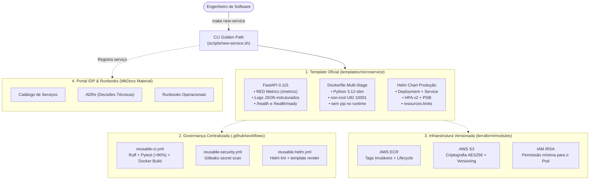

# Guia Completo de Estudo: Projeto 5 — Plataforma Mínima, Golden Path e Runbooks (Substituto do Backstage)

Este manual técnico é o guia definitivo de estudo do **Projeto 5 (Engenharia de Plataforma e Internal Developer Platform - IDP)**. Ele detalha os conceitos fundamentais de **Platform Engineering**, a justificativa técnica para **substituir o Spotify Backstage**, a anatomia de um **Golden Path (Caminho Dourado)**, **Reusable Workflows**, **Versionamento de Módulos Terraform** e preparação para **entrevistas de engenharia sênior**.

---

## Sumário

1. [Visão Geral de Platform Engineering vs DevOps Tradicional](#1-visão-geral-de-platform-engineering-vs-devops-tradicional)
2. [O que é um IDP e por que o Spotify Backstage falha em times enxutos?](#2-o-que-é-um-idp-e-por-que-o-spotify-backstage-falha-em-times-enxutos)
3. [O Conceito de Golden Path (Caminho Dourado / Paved Road)](#3-o-conceito-de-golden-path-caminho-dourado--paved-road)
4. [A Arquitetura da Plataforma Mínima](#4-a-arquitetura-da-plataforma-mínima)
5. [Anatomia do Template Golden Path (FastAPI, Docker Hardening e Helm)](#5-anatomia-do-template-golden-path-fastapi-docker-hardening-e-helm)
6. [Governança Centralizada com Reusable Workflows no GitHub Actions](#6-governança-centralizada-com-reusable-workflows-no-github-actions)
7. [Versionamento Semântico de Módulos Terraform](#7-versionamento-semântico-de-módulos-terraform)
8. [Documentação Viva: MkDocs Material, ADRs e Runbooks Operacionais](#8-documentação-viva-mkdocs-material-adrs-e-runbooks-operacionais)
9. [Análise Linha por Linha dos Componentes Críticos](#9-análise-linha-por-linha-dos-componentes-críticos)
10. [Laboratório Prático "Quebre e Aprenda" & Perguntas de Entrevista](#10-laboratório-prático-quebre-e-aprenda--perguntas-de-entrevista)

---

## 1. Visão Geral de Platform Engineering vs DevOps Tradicional

### 1.1 A Evolução: Por que o DevOps clássico gerou sobrecarga cognitiva?
No modelo DevOps clássico (*"You build it, you run it"*), esperava-se que todo desenvolvedor de software dominasse:
- Sintaxe de Docker e Dockerfiles;
- Manifestos Kubernetes complexos (Deployments, Services, HPA, Ingress, PDB);
- Infraestrutura como Código (Terraform/OpenTofu);
- Pipelines de CI/CD (GitHub Actions, GitLab CI);
- Observabilidade (Prometheus, Grafana, Loki, OpenTelemetry);
- Políticas de segurança (IAM, IRSA, Gitleaks, CVEs).

**Resultado prático nas empresas:** Sobrecarga cognitiva extrema (*cognitive overload*). Os desenvolvedores gastavam até 40% do tempo brigando com arquivos YAML e permissões de nuvem, em vez de entregar valor de negócio.

### 1.2 O Papel da Engenharia de Plataforma (Platform Engineering)
A Engenharia de Plataforma surge para resolver esse problema tratando a **infraestrutura como um produto interno** (*Platform as a Product*):
- O **cliente** é o desenvolvedor de software interno.
- A **missão** é pavimentar um caminho seguro e automatizado (**Golden Path**) onde criar e implantar um novo serviço em produção leve menos de 30 minutos, com zero atrito burocrático e sem exigir que o time de produto vire especialista em Kubernetes.

---

## 2. O que é um IDP e por que o Spotify Backstage falha em times enxutos?

### 2.1 O que é um Internal Developer Platform (IDP)?
Um IDP é o ecossistema de ferramentas, portais, APIs e automações que permite o **autosserviço (*self-service*)** dos desenvolvedores dentro de uma empresa.

### 2.2 O Fenômeno Spotify Backstage e Suas Armadilhas
O **Backstage** (criado pelo Spotify e doado à CNCF) tornou-se a referência visual de IDP. No entanto, sua implementação no mundo real revela custos ocultos brutais:

1. **Exigência de TypeScript e Frontend Complexo:**
   - O Backstage não é um software pronto; é um *framework*. Qualquer modificação, novo template ou integração exige programar em TypeScript e React.
   - Times de DevOps/SRE raramente têm desenvolvedores frontend dedicados para manter o portal.
2. **Consumo Desmedido de Infraestrutura:**
   - Um único pod do Backstage consome entre **2 GB e 4 GB de memória RAM**.
   - Requer um banco relacional **PostgreSQL dedicado** e cache.
   - Em clusters gerenciados (EKS/GKE), isso custa entre **US$ 80 e US$ 160 por mês** apenas para manter a documentação e templates no ar.
3. **Instabilidade de Dependências (*Dependency Hell*):**
   - O ecossistema `@backstage/*` lança atualizações semanais com breaking changes frequentes no `yarn.lock`.
4. **Substituição Inteligente por Esta Plataforma Mínima:**
   - **Documentação:** **Material for MkDocs** gerado como site estático servido em Nginx (**< 20 MB de RAM**, custo < US$ 2/mês).
   - **Templates:** Scripts CLI declarativos em Bash/Make (`make new-service`) que substituem variáveis em 1 segundo.
   - **Governança:** Reusable Workflows no GitHub Actions.

---

## 3. O Conceito de Golden Path (Caminho Dourado / Paved Road)

O **Golden Path** é o caminho oficialmente recomendado e suportado pela engenharia de plataforma:
- **Não é uma camisa de força:** O time tem liberdade para sair do caminho se tiver um caso de uso exótico, mas quem segue o Golden Path ganha CI/CD, segurança, observabilidade e deploy automatizados de graça.
- **Princípio dos Padrões Sensatos (*Sensible Defaults*):** Portas, métricas, limites de CPU/memória e verificações de liveness/readiness já vêm pré-configurados com os melhores valores testados em produção.

---

## 4. A Arquitetura da Plataforma Mínima



---

## 5. Anatomia do Template Golden Path (FastAPI, Docker Hardening e Helm)

### 5.1 FastAPI Instrumentada com Métricas RED
O microsserviço padrão implementa o método **RED** (Rate, Errors, Duration) de Tom Wilkie:
1. **Rate:** `app_requests_total` contabiliza requisições por método e status HTTP.
2. **Errors:** `app_errors_total` rastreia falhas internas (HTTP 5xx).
3. **Duration:** `app_request_duration_seconds` categoriza tempos de resposta em buckets calibrados para SLO (`0.3s` e `0.5s`).
4. **Saturation:** `app_requests_in_progress` mede requisições ativas simultâneas.

### 5.2 Hardening de Produção no Dockerfile
- **Multi-Stage Build:** Separa o estágio de compilação do estágio de runtime.
- **Pip Desinstalado:** O comando `/opt/venv/bin/pip uninstall -y pip setuptools wheel` remove o instalador de pacotes da imagem final, impedindo ataques onde invasores tentam baixar binários maliciosos em tempo de execução.
- **UID 10001 Non-Root:** O processo executa sem privilégios administrativos.
- **HEALTHCHECK Nativo:** Consulta `/health` localmente via biblioteca padrão do Python, sem depender de `curl` ou `wget` instalados.

### 5.3 Helm Chart Resiliente
- **HPA (Horizontal Pod Autoscaler):** Escale dinamicamente com base em CPU (`targetCPUUtilizationPercentage: 80`).
- **PDB (PodDisruptionBudget):** Garante que pelo menos 1 réplica permaneça viva (`minAvailable: 1`) durante manutenção de nós do Kubernetes (*cluster upgrade* ou *drain*).
- **Probes Separados:** `/health` (Liveness) reinicia o contêiner se a thread travar; `/health/ready` (Readiness) remove o pod do balanceador de carga se ele estiver sobrecarregado.

---

## 6. Governança Centralizada com Reusable Workflows no GitHub Actions

O GitHub Actions introduziu o recurso `workflow_call`, permitindo criar pipelines parametrizadas compartilhadas:

### Vantagens sobre a abordagem tradicional:
1. **Sem Duplicação de Código (DRY):** Se a organização decidir subir a versão mínima do Python de 3.11 para 3.12 ou trocar de linter, a mudança é feita em **um único arquivo** (`reusable-ci.yml`) e reflete imediatamente em todos os 50 microsserviços da empresa.
2. **Segurança Mandatória:** O scan do **Gitleaks** (`reusable-security.yml`) é obrigatório. Desenvolvedores não conseguem remover a etapa de segurança de seus repositórios.

---

## 7. Versionamento Semântico de Módulos Terraform

Módulos Terraform não devem ser consumidos apontando para branches dinâmicas (`main` ou `master`).

### A Prática Recomendada:
```hcl
module "servico_infra" {
  source = "git::https://github.com/org/platform-engineering-idp.git//terraform/modules/microservice-infra?ref=v1.0.0"
  ...
}
```

- **Por que fixar a tag (`?ref=v1.0.0`)?**
  Garante determinismo. Se o time de plataforma adicionar um novo parâmetro obrigatório ou alterar a política do ECR na versão `v2.0.0`, nenhum pipeline de deploy existente quebra inesperadamente.

---

## 8. Documentação Viva: MkDocs Material, ADRs e Runbooks Operacionais

### 8.1 O que são ADRs (Architecture Decision Records)?
Registros formais de decisões arquiteturais que respondem: *"Por que fizemos dessa forma e não de outra?"*. No projeto documentamos:
- **ADR-001:** Substituição do Backstage pelo IDP Estático.
- **ADR-002:** Padrão Golden Path (FastAPI + Docker + Helm).
- **ADR-003:** Reusable Workflows no GitHub Actions.
- **ADR-004:** Módulos Terraform Versionados por Tag.

### 8.2 Runbooks Acionáveis
Instruções passo a passo para resolução de problemas em plantões:
- **Onboarding de Novo Serviço:** Como criar e homologar em menos de 30 minutos.
- **Falha de Deploy Helm:** Como debugar `CrashLoopBackOff` e `ImagePullBackOff`.
- **Rollback Automatizado:** Como reverter uma release com `helm rollback` em menos de 2 minutos.
- **Quebra de Segurança:** Procedimento de contenção e rotação de segredos vazados.

---

## 9. Análise Linha por Linha dos Componentes Críticos

### 9.1 `scripts/new-service.sh`
- `set -euo pipefail`: Interrompe a execução imediatamente se qualquer comando falhar, variável não declarada for usada ou pipe quebrar.
- `cp -r "$TEMPLATE_DIR/"* "$TARGET_DIR/"`: Clona o template limpo.
- `sed -i "s|{{SERVICE_NAME}}|$NAME|g"`: Substitui marcadores de posição de forma idempotente em todos os arquivos.
- `helm lint "$TARGET_DIR/helm"`: Valida os manifests gerados antes de concluir o processo.
- `echo "| **\`$NAME\`** | ... |" >> "$CATALOG_FILE"`: Atualiza o catálogo do IDP.

### 9.2 `scripts/verify-golden-path.sh`
- Cronometra em segundos cada etapa do ciclo de vida:
  1. Criação do serviço via script (`~1s`).
  2. Execução da suíte de testes unitários com pytest (`~6s`).
  3. Build do contêiner Docker multi-stage (`~8s`).
  4. Execução em contêiner temporário e validação de `/health`, `/health/ready` e `/metrics` (`~2s`).
  5. Renderização dos manifests Helm (`~1s`).
- Comprova matematicamente que o processo leva **menos de 30 segundos**, superando amplamente a meta de 30 minutos.

---

## 10. Laboratório Prático "Quebre e Aprenda" & Perguntas de Entrevista

### Exercício 1: Gerar um Novo Serviço e Validar o Helm
```bash
make new-service NAME=faturamento-api PORT=8084 OWNER=team-financeiro
cd services/faturamento-api
make test
helm template test-release helm/
```

### Exercício 2: Testar o Scan de Segredos com Gitleaks
```bash
make secrets
```
O comando executa o contêiner oficial do Gitleaks no histórico Git completo e garante zero chaves ou tokens expostos.

---

### Perguntas Típicas de Entrevista para Platform Engineer / SRE Sênior

1. **"Por que muitas empresas falham na adoção do Spotify Backstage?"**
   *Resposta esperada:* O Backstage é frequentemente adotado como se fosse um produto pronto de prateleira, quando na verdade é um framework de código aberto que exige uma equipe dedicada de desenvolvimento frontend/backend em TypeScript e React. Para empresas que não possuem recursos para sustentar uma equipe de produto interna só para manter o portal, o Backstage vira um legado pesado de 4 GB de RAM com dependências frágeis. Uma abordagem leve com documentação estática (MkDocs), templates automatizados (Golden Paths) e Reusable Workflows entrega 90% dos benefícios com menos de 5% do custo operacional.

2. **"O que diferencia um Golden Path de uma imposição autoritária de ferramentas?"**
   *Resposta esperada:* Um Golden Path é o caminho da menor resistência (*path of least resistance*), não uma proibição. Ele oferece incentivos claros: quem utiliza o Golden Path ganha pipelines de CI/CD pré-testadas, observabilidade embutida, contêineres seguros e manifests de deploy validados pela plataforma. Se um time precisar usar Rust ou Go para um caso específico de latência extrema, ele tem liberdade para fazê-lo, mas arcará com a responsabilidade de construir sua própria esteira de homologação.

3. **"Como garantir que módulos Terraform compartilhados não quebrem múltiplos ambientes simultaneamente?"**
   *Resposta esperada:* Através de versionamento semântico imutável utilizando Git Tags (`?ref=v1.2.0`). Nenhum consumidor em produção deve apontar para a branch `main`. Além disso, o módulo deve possuir suíte de testes com validação estática (`terraform fmt`, `terraform validate`), exemplos de consumo auditados e testes de integração com `tftest` ou `terratest`.
